<p align="center">
  
</p>

<h1 align="center">A P E I R O N</h1>

<p align="center">
  <em>An opinionated factory for full-stack businesses —<br>
  every project born complete, every line readable by humans and AI agents alike.</em>
</p>

<p align="center">
  
</p>

---

<p align="center">
  
</p>

<p align="center">
  <sub><em>Anaximander, twenty-six centuries ago, named the immortal source</em></sub><br>
  <sub><em>from which all worlds arise — and to which they return.</em></sub>
</p>

<p align="center">
  <strong>This is that idea, as a repository:</strong><br>
  one boundless source, every platform you will ever build.
</p>

## ◆ The concept

Most templates give you a folder. **Apeiron gives you a worldview.** It encodes one deliberate, opinionated way to build a software business — so that project number one and project number twenty share the same skeleton, the same conventions, the same muscle memory.

You answer a handful of questions; a complete, deployed, branded platform answers back:

| | You are asked | You receive |
|---|---|---|
| ◈ | a name, a domain, an org | identity wired through web, webapp, mobile, API, CI |
| ⬡ | groups · roles · features | the entire RBAC layer as **code** — enums, gates, mirrored UI policies, seed personas, Pest spec |
| ✦ | a hue (or *surprise me*) | a gamut-mapped oklch palette, minted live in your terminal, driving every surface — same brand from landing page to mobile theme, served from the backend |
| ● | a design soul | a distinct, beautiful website — same anatomy every time, a different face every project |
| ▲ | secrets (optional) | an idempotent AWS provisioner — buckets, IAM users, EC2 per environment, Cloudflare DNS — plus a ready-to-run `gh` checklist |

<p align="center">
  
</p>

## ✦ Four souls, one skeleton

Every generated website shares the same anatomy — hero → features
→ steps → pricing → faq → contact — restyled by a soul. Components
know nothing about which skin is live; the soul owns the surface.

<p align="center">
  
</p>

## ◆ The stack

Versions live in the manifests — `composer.json`, `package.json`,
`pubspec.yaml` — and nowhere else. The prose stays evergreen.

| Layer | The opinion |
|---|---|
| API | **Laravel** — Octane (Swoole) · Sanctum · Pennant · Horizon · Reverb · Pest |
| Data | Postgres · Redis · S3 (MinIO locally, AWS in production) |
| Webapp | **Nuxt** — Nuxt UI · Tailwind · Sanctum auth · VueUse · no Pinia |
| Website | **Nuxt** static — Nuxt UI · prerendered, S3 + CDN'd |
| Mobile | **Flutter** — freezed · injectable · Cubits · auto_route · dio |
| Cloud | **AWS** — EC2 swarm host · S3 buckets · IAM users, minted by an idempotent provisioner |
| Edge | **Cloudflare** DNS — Traefik terminates TLS via DNS-01 |
| Ship | Docker Swarm · Traefik · GHCR · GitHub Actions |
| Stores | **Google Play** (internal track) + **App Store** (TestFlight) — every tag, zero human hands |
| Watch | Loki · Grafana · Discord release pings |
| Craft | pnpm workspace · Make · Prettier · php-cs-fixer · dart format · MCP |

## ▲ The remote platform

Tag a release and walk away — the train knows every stop:

<p align="center">
  
</p>

The stores get theirs too — every tag is signed and uploaded unattended: no certificates dragged around laptops, no Xcode opened, no human in the loop.

<p align="center">
  
</p>

### ● The zero-ops checklist

Everything between *git tag* and *serving customers* is idempotent, self-healing, and narrated on Discord — green or red. The checklist runs itself; you watch it happen:

<p align="center">
  
</p>

### ⚡ An API that never boots twice

Classic PHP folds the framework after every request. Octane + Swoole boot once and stay hot in worker memory — coroutine I/O, `scoped()` per-request state, one image running API, queues, websockets and cron.

<p align="center">
  
</p>

Laravel with Node-class latency — on the same hardware, routinely faster.

## ⬡ Permissions are code

No roles tables. No permission seeders. No cache drift. Four string
enums and one gate — the matrix *is* the source of truth, mirrored
to the frontend on the user payload, tested as a spec:

```php
// apps/backend/app/Enums/Group.php — generated from your answers
public function resolve(Role $role): array
{
    return match ($this) {
        default => [],
        Group::CLIENT => match ($role) {
            default => [],
            Role::MANAGER => [
                Feature::WIDGET => [
                    Action::INDEX,
                    Action::READ,
                    Action::CREATE,
                    Action::UPDATE,
                ],
            ],
        },
    };
}
```

```ts
// apps/frontend — the same matrix, mirrored at scaffold time
can('widget', 'create')   // ← reads user.policies['widget:create']
<Gate feature="widget" action="create"> … </Gate>
```

```dart
// apps/mobile — same payload, same gate
user.can('widget', 'create');
```

One matrix. Three surfaces. Zero divergence.

## ● Built for two readers

Every project ships an **agent curriculum** — a first-class artifact, not an afterthought. `AGENTS.md` is the map, `ai/conventions` the law per surface, `ai/playbooks` the end-to-end recipes. Humans and agents read the same book — and land byte-identical commits.

<p align="center">
  
</p>

An agent that has never seen your project can add a feature end-to-end by reading one playbook. A human can too. That's the point.

## ▲ Quickstart

```bash
git clone <this repo> && cd apeiron

node .                                 # interactive — palette preview in your terminal
node . --list-souls                    # meet the four souls
node . --answers answers.example.json --out ../my-next-business
```

Then, inside the newborn platform:

```bash
pnpm install
cd apps/backend && composer install && cp .env.example .env
php artisan key:generate && php artisan migrate --seed
cd ../..
make services   # postgres + redis + minio
make dev        # webapp + api + websockets + queues + logs — color-coded, real local domains
```

Push a tag → images publish to GHCR → the Swarm rolls → Play and
TestFlight get their builds → Discord pings. That's the whole
release train.

## ◆ The map

| Path | Role |
|---|---|
| `index.mjs` | the factory gate — `node .`, interactive or `--answers` for agents |
| `lib/` | prompts TUI · oklch engine · renderer · rbac generator · builders · provisioner |
| `boilerplate/` | the platform tree — 250+ files, rendered per project |
| `styling/souls/` | aurora · blueprint · editorial · neon |
| `ai/` | the agent curriculum, shipped into every project |
| `docs/` | the SVGs above — drawn in Apeiron's own generated palette |

Agents working *on* Apeiron itself: read [`AGENTS.md`](AGENTS.md).

---

<p align="center">
  <em>The palette of this very page — <code>#988cff</code> violet,
  <code>#00b4bf</code> teal — was generated by Apeiron from hue 286.</em><br>
  <strong>From the boundless, worlds.</strong>
</p>
