<p align="center">
  
</p>

<h1 align="center">A P E I R O N</h1>

<p align="center">
  <em>An opinionated factory for full-stack businesses —<br>
  every project born complete, every line readable by humans and AI agents alike.</em>
</p>

<p align="center">
  
</p>

---

> **ἄπειρον** — *the boundless.* Anaximander, 26 centuries ago, named the
> immortal source from which all worlds arise and to which they return.
> This is that idea, as a repository: **one boundless source, every
> platform you will ever build.**

## ◆ The concept

Most templates give you a folder. **Apeiron gives you a worldview.**

It encodes one deliberate, opinionated way to build a software
business — so that project number one and project number twenty
share the same skeleton, the same conventions, the same muscle
memory. You answer a handful of questions; a complete, deployed,
branded platform answers back:

| | You are asked | You receive |
|---|---|---|
| ◈ | a name, a domain, an org | identity wired through web, webapp, mobile, API, CI |
| ⬡ | groups · roles · features | the entire RBAC layer as **code** — enums, gates, mirrored UI policies, seed personas, Pest spec |
| ✦ | a hue (or *surprise me*) | a gamut-mapped oklch palette, minted live in your terminal, driving every surface — same brand from landing page to mobile theme, served from the backend |
| ● | a design soul | a distinct, beautiful website — same anatomy every time, a different face every project |
| ▲ | secrets (optional) | an idempotent AWS provisioner — buckets, IAM users, EC2 per environment, Cloudflare DNS — plus a ready-to-run `gh` checklist |

<p align="center">
  
</p>

## ✦ Four souls, one skeleton

Every generated website shares the same anatomy — hero → features
→ steps → pricing → faq → contact — restyled by a soul. Components
know nothing about which skin is live; the soul owns the surface.

<p align="center">
  
</p>

## ⬡ Permissions are code

No roles tables. No permission seeders. No cache drift. Four string
enums and one gate — the matrix *is* the source of truth, mirrored
to the frontend on the user payload, tested as a spec:

```php
// apps/backend/app/Enums/Group.php — generated from your answers
public function resolve(Role $role): array
{
    return match ($this) {
        default => [],
        Group::CLIENT => match ($role) {
            default => [],
            Role::MANAGER => [
                Feature::WIDGET => [
                    Action::INDEX,
                    Action::READ,
                    Action::CREATE,
                    Action::UPDATE,
                ],
            ],
        },
    };
}
```

```ts
// apps/frontend — the same matrix, mirrored at scaffold time
can('widget', 'create')   // ← reads user.policies['widget:create']
<Gate feature="widget" action="create"> … </Gate>
```

```dart
// apps/mobile — same payload, same gate
user.may('widget', 'create');
```

One matrix. Three surfaces. Zero divergence.

## ● Built for two readers

Every project ships with an **agent curriculum** — not an
afterthought, a first-class artifact:

```
AGENTS.md                    ← the map an agent reads first
ai/conventions/backend.md    ← the law per surface
ai/conventions/frontend.md   ← components: global vs feature · composables: app vs feature
ai/conventions/mobile.md     ← injectable · cubits · freezed · server-driven theme
ai/playbooks/add-feature.md  ← enum → matrix → controller → nav → gates, end to end
ai/playbooks/rbac.md         ← the model, the resolution chain, the never-list
```

The style law is enforced by fixers — Prettier, php-cs-fixer, dart
format — so a human's commit and an agent's commit converge on
**byte-identical formatting**. Pest is the shared truth both must
keep green. MCP servers (Laravel Boost, Nuxt, Nuxt UI) are wired in
`.mcp.json` so any agent works with live, version-matched docs.

An agent that has never seen your project can add a feature
end-to-end by reading one playbook. A human can too. That's the
point.

## ▲ Quickstart

```bash
git clone <this repo> && cd apeiron

node scaffold.mjs                      # interactive — palette preview in your terminal
node scaffold.mjs --list-souls         # meet the four souls
node scaffold.mjs --answers answers.example.json --out ../my-next-business
```

Then, inside the newborn platform:

```bash
pnpm install
cd apps/backend && composer install && cp .env.example .env
php artisan key:generate && php artisan migrate --seed
cd ../..
make services   # postgres + redis + minio
make dev        # webapp + api + websockets + queues + logs — color-coded, real local domains
```

Push a tag → images publish → the Swarm rolls → Discord pings.
That's the whole release train.

## ◆ The map

| Path | Role |
|---|---|
| `scaffold.mjs` | the factory gate — interactive or `--answers` for agents |
| `lib/` | prompts TUI · oklch engine · renderer · rbac generator · builders · provisioner |
| `boilerplate/` | the platform tree — 250+ files, rendered per project |
| `styling/souls/` | aurora · blueprint · editorial · neon |
| `ai/` | the agent curriculum, shipped into every project |
| `docs/` | the SVGs above — drawn in Apeiron's own generated palette |

Agents working *on* Apeiron itself: read [`AGENTS.md`](AGENTS.md).

---

<p align="center">
  <em>The palette of this very page — <code>#988cff</code> violet,
  <code>#00b4bf</code> teal — was generated by Apeiron from hue 286.</em><br>
  <strong>From the boundless, worlds.</strong>
</p>
