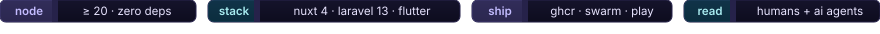
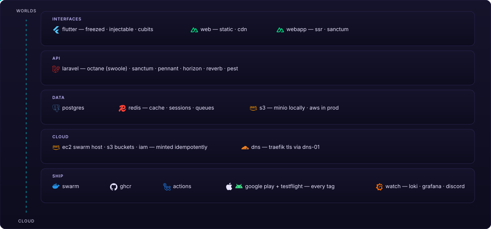
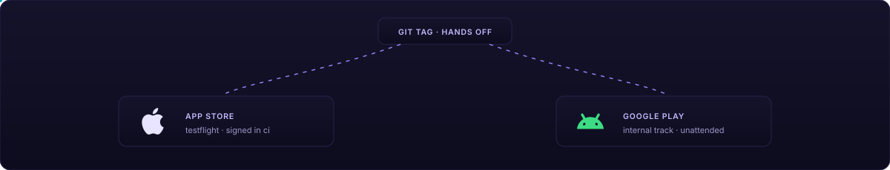
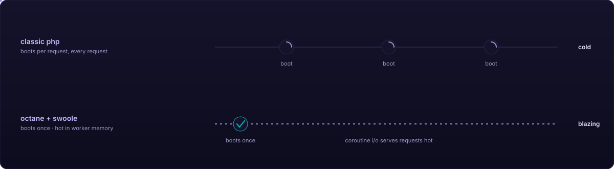
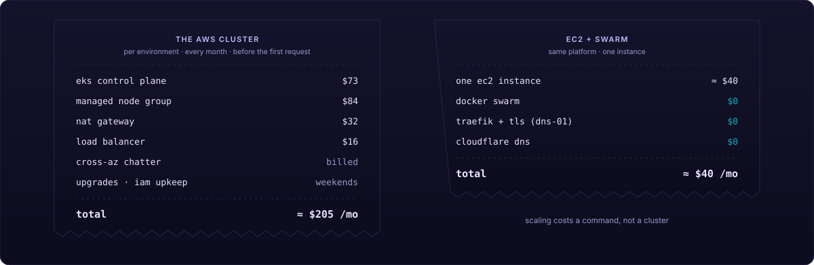
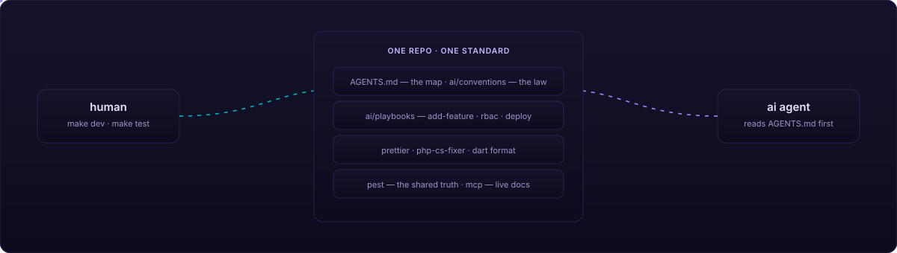
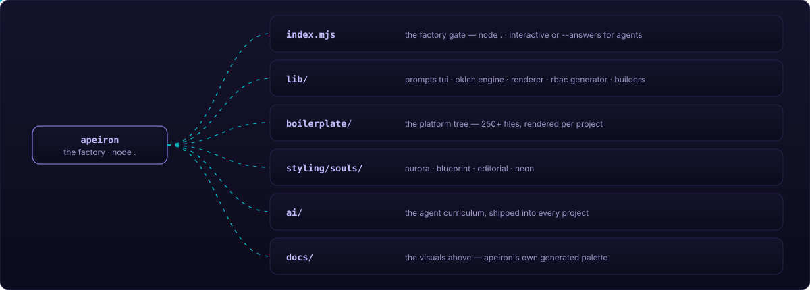

<p align="center">
  
</p>

<h1 align="center"> ἄ π ε ι ρ ο ν </h1>

<p align="center">
  <em>An opinionated factory for full-stack businesses —<br>
  every project born complete, every line readable by humans and AI agents alike.</em>
</p>

<p align="center">
  
</p>

> ⚠️ **In active development** — expect breaking changes between releases. Built for professionals who run their own infrastructure; others should wait for the stable release.

---

<p align="center">
  <sub><em>·&nbsp;&nbsp;A P E I R O N&nbsp;&nbsp;·</em></sub>
</p>

<p align="center">
  <em>Anaximander, twenty-six centuries ago, named the immortal source<br>
  from which all worlds arise — and to which they return.</em>
</p>

<p align="center">
  <strong>This is that idea, as a repository:</strong><br>
  one boundless source, every platform you will ever build.
</p>

<p align="center">
  <sub>◆&nbsp;&nbsp;✦&nbsp;&nbsp;⬡&nbsp;&nbsp;●&nbsp;&nbsp;▲</sub>
</p>

## ◆ The concept

Most templates give you a folder. **Apeiron gives you a worldview** — one deliberate, opinionated way to build a software business, so that project one and project twenty share the same skeleton, the same conventions, the same muscle memory.

You answer five questions. A complete, deployed, branded platform answers back.

> **◈** _a name, a domain, an org_

**Identity** — wired through the website, the webapp, mobile, the API and CI. Every surface knows who it is.

> **⬡** _groups · roles · features_

**Permissions** — the whole RBAC layer as code: enums, gates, mirrored UI policies, seed personas, and a Pest spec that proves it.

> **✦** _a hue — or “surprise me”_

**A palette** — gamut-mapped oklch, minted live in your terminal, driving every surface from landing page to mobile theme. One brand, served from the backend.

> **●** _a design soul_

**A website** — the same anatomy every time, a different face every project. Hero to contact, restyled by the soul.

> **▲** _secrets_

**A cloud** — an idempotent AWS provisioner: buckets, IAM users, EC2 per environment, Cloudflare DNS — and one command pushes every derived secret to GitHub for you.

## ✦ Four souls, one skeleton

Every generated website shares the same anatomy — hero → features → steps → pricing → faq → contact — restyled by a soul. Components know nothing about which skin is live; the soul owns the surface.

<p align="center">
  
</p>

## ◆ The stack

Versions live in the manifests — `composer.json`, `package.json`, `pubspec.yaml` — and nowhere else; the prose stays evergreen. Five strata, one opinion each — the platform arises from the cloud substrate upward:

<p align="center">
  
</p>

## ▲ The remote platform

Tag a release and walk away — the train knows every stop:

<p align="center">
  
</p>

The stores get theirs too — every tag is signed and uploaded unattended: no certificates dragged around laptops, no Xcode opened, no human in the loop.

<p align="center">
  
</p>

### ● The zero-ops checklist

Everything between _git tag_ and _serving customers_ is idempotent, self-healing, and narrated on Discord — green or red. The checklist runs itself; you watch it happen:

<p align="center">
  
</p>

### ⚡ An API that never boots twice

Classic PHP folds the framework after every request. Octane + Swoole boot once and stay hot in worker memory — coroutine I/O, `scoped()` per-request state, one image running API, queues, websockets and cron.

<p align="center">
  
</p>

Laravel with Node-class latency — on the same hardware, routinely faster.

### ◈ Scaling — the cluster bill, skipped

Scaling is role-shaped, not instance-shaped: `docker service scale <stack>_backend=4` grows the API, `<stack>_horizon=2` grows the queues — same image, another temper. No control plane to feed, no balancer to rent.

<p align="center">
  
</p>

Vertical first — Octane keeps the app hot in memory with coroutine I/O, and Swarm packs replicas onto the instance edge to edge: one host does the work of a small fleet. Horizontal when you outgrow it: `docker swarm join` a second EC2 and the overlay network, placement and Traefik re-converge themselves; Horizon workers fit Spot instances perfectly, since Swarm reschedules a killed node's replicas. And it is automatic: `autoscale.sh` runs on the host as a systemd unit, watches **Traefik's own request metrics**, and calls `docker service scale` — replicas rise the moment traffic does, and step back down only after three calm windows, so it never flaps. Bounds and sensitivity live in `/etc/apeiron/autoscale.env`.

## ⬡ Permissions are code

No roles tables. No permission seeders. No cache drift. Four string enums and one gate — the matrix _is_ the source of truth, mirrored to the frontend on the user payload, tested as a spec:

```php
// apps/backend/app/Enums/Group.php — generated from your answers
public function resolve(Role $role): array
{
    return match ($this) {
        default => [],
        Group::CLIENT => match ($role) {
            default => [],
            Role::MANAGER => [
                Feature::WIDGET => [
                    Action::INDEX,
                    Action::READ,
                    Action::CREATE,
                    Action::UPDATE,
                ],
            ],
        },
    };
}
```

```ts
// apps/frontend — the same matrix, mirrored at scaffold time
can('widget', 'create')
<Gate feature="widget" action="create"> … </Gate>
```

```dart
// apps/mobile — same payload, same gate
user.can('widget', 'create');
```

One matrix. Three surfaces. Zero divergence.

## ● Built for two readers

Every project ships an **agent curriculum** — a first-class artifact, not an afterthought. `AGENTS.md` is the map, `ai/conventions` the law per surface, `ai/playbooks` the end-to-end recipes. Humans and agents read the same book — and land byte-identical commits.

<p align="center">
  
</p>

An agent that has never seen your project can add a feature end-to-end by reading one playbook. A human can too. That's the point.

## ▲ Quickstart

```bash
git clone https://github.com/snarcraft/apeiron.git && cd apeiron

node .                                 # interactive — palette preview in your terminal
node . --list-souls                    # meet the four souls
node . --answers answers.example.json --out ../my-next-business
```

Then, inside the newborn platform:

```bash
pnpm install
cd apps/backend && composer install
php artisan key:generate && php artisan migrate --seed
cd ../..
make services   # postgres + redis + minio
make dev        # webapp + api + websockets + queues + logs — color-coded, real local domains
```

Mobile, when you want the app too:

```bash
cd apps/mobile && flutter pub get
flutter create --org com.yourorg --project-name yourapp .   # platform folders — once
cd ../..
make codegen    # freezed · json · router codegen, watch mode
make mobile     # the app, against the same backend
```

Push a tag → images publish to GHCR → the Swarm rolls → Play and TestFlight get their builds → Discord pings. That's the whole release train.

## ◆ The map

<p align="center">
  
</p>

Agents working _on_ Apeiron itself: read [`AGENTS.md`](AGENTS.md).

---

<p align="center">
  <em>The palette of this very page — <code>#988cff</code> violet, <code>#00b4bf</code> teal — was generated by Apeiron from hue 286.</em><br>
  <strong>From the boundless, worlds.</strong>
</p>
